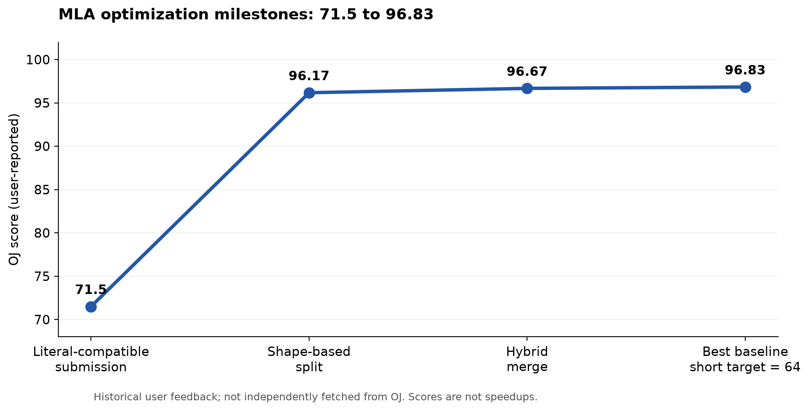

# DeepSeek MLA：HeteMCP / DSH 优化档案与汇报材料

整理日期：2026-11-01（Asia/Shanghai）。历史实验覆盖 2026-10-26—2026-10-30。

最佳已确认结果是用户反馈的 **OJ 96.83 分、六点合计 474μs**，源码为 [code/MLA.py](code/MLA.py)，SHA-256：
`5e3efcc1da528d72a1909292f505e8fcef560dee0eb7e4f8133b257e8583668c`。
OJ 六点耗时为 **20 / 26 / 39 / 64 / 114 / 211μs**，对应 batch1、heads16、context2048—65536。
该成绩来源于历史用户反馈和用户提供的完整源码，未独立拉取 OJ 提交记录。**尚未达到 97 分。**

| 阅读目的 | 入口 |
|---|---|
| 优化过程、里程碑和关键转折 | [优化过程](docs/HISTORY.md) |
| 适合汇报的技术创新、代码与证据 | [创新点](docs/INNOVATIONS.md) |
| 成功、否决、待 OJ 的全部机制归类 | [实验结论表](docs/EXPERIMENTS.md) |
| Codex → HeteMCP → DSH 的分工、验收与复现 | [方法与复现](docs/METHODOLOGY.md) |
| 12 页 PPT 大纲、讲稿、图表和代码摘录 | [PPT 素材](slides/PPT_MATERIALS.md) |
| 每份历史文件的来源及 SHA | [来源清单](SOURCE_MANIFEST.json) |
| 真实任务终态、attempt 和 artifact SHA | [HeteMCP 摘要](evidence/hetemcp_tasks.json) |

当前候选与最佳版本必须分开管理：

| 文件 | SHA 前缀 | 验证及结论 |
|---|---|---|
| [最佳基线](code/MLA.py) | `5e3efcc1da` | 用户反馈 OJ 96.83 / 474μs；本地文件与最佳备份逐字节一致 |
| [PV stream B4](code/MLA.candidate-pvstream-B4-20261030.py) | `01a2c12bc5` | 本地核心6点、完整31点双 seed 通过；小幅收益；OJ 待测 |
| [Deferred sum](code/MLA.candidate-deferredsum-20261030.py) | `3b20aa59e4` | 本地核心6点、完整31点双 seed 通过；最长 context 约快1.96%；OJ 待测 |
| [QK128 分块](code/MLA.candidate-qkchunk128-20261028.py) | `9699e7d193` | 本地通过且加速；用户反馈 OJ 96.17 / 712μs，否决 |

本目录独立于仓库已有 `mla_decode/` 的另一条优化历史，分数、版本号与 benchmark 不能混用。
`code/`、`reproduce/` 和选定原始 JSON 保留原字节；`reports/` 是加历史时点说明并脱敏的报告。
旧报告中的“当前”并非归档当前状态；最新结论以本页和实验表为准。

本次工作仅整理已有代码、报告和证据，未重新执行 SSH/GPU 或提交 OJ，未修改原优化实现。
不包含 SSH/数据库密码、DSH 凭据、完整会话、TaskSpec 大 prompt、数据库卷或二进制大包。
源码快照包含失败版本，请按实验表选择，不能把所有快照当作可部署实现。

离线校验（仅 Python 标准库，无需 GPU）：

```bash
python ds_mla/tools/verify_archive.py
```


