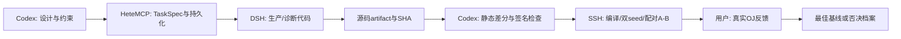

# 调度、验收与可复现材料

## 历史分工



单次实验固定基线SHA，限定一个机制和允许修改区域。TaskSpec只允许单文件生成，
`generated-file-scope`是文件范围验收。独立审查之后才进行真实编译、核心六点A/B；
出现有效收益才继续原31点。失败、超时和未完成产物按原状态保留。
本轮未调用DSH重新写生产算子，也未声称重新跑过历史GPU验证。

## 证据分层

| 层级 | 能支持的结论 | 不能支持的结论 |
|---|---|---|
| HeteMCP任务终态 | DSH完成生成、范围check结果 | 编译正确、数值正确、加速 |
| AST/literal/签名 | Python结构与OJ loader形式兼容 | TileLang后续pass正确 |
| compile / IR / ELF | 指定环境编译及资源字段 | GPU执行正确、实际动态spill次数 |
| 原参考数值回归 | 指定shape/seed/容差通过 | 任意shape正确 |
| SSH同轮paired A/B | 当轮服务器相对性能 | OJ分数或OJ绝对耗时 |
| 真实OJ反馈 | 用户报告的该次提交成绩 | 跨版本精确根因、稳定微小收益 |

## 归档验证

```bash
python ds_mla/tools/verify_archive.py
```

验证来源清单中的归档SHA，解析Python/JSON，核对最佳源码、核心CSV与原始JSON、候选双seed31点结果，
核对源码摘录行号和相对文件链接，扫描发布材料中的连接凭据模式。不会导入/执行TileLang。

## GPU复现（在已有MetaX环境中执行）

本档案提供原字节 [paired benchmark](../reproduce/fair_benchmark.py)、
[原参考](../reproduce/reference.py) 和 [31点case](../reproduce/cases.json)。
环境需要已构建的MetaX TileLang、MACA运行时及其配套torch、einops等；本档案不是封装好的容器镜像。
按原环境配置 `MACA_PATH`、`USE_MACA=ON`、`PYTHONPATH`、PATH和LD_LIBRARY_PATH，保持原参考和容差。
从仓库根目录执行，输出写入新目录：

```bash
mkdir -p mla_results
python ds_mla/reproduce/fair_benchmark.py \
  --baseline ds_mla/code/MLA.py \
  --candidate ds_mla/code/MLA.candidate-deferredsum-20261030.py \
  --reference ds_mla/reproduce/reference.py \
  --cases ds_mla/reproduce/cases.json \
  --ids 1,2,3,4,5,6 --trials 7 --repeats 100 --warmup 200 \
  --output mla_results/deferred_sum_core.json
```

数值验证seed0/42；计时使用seed0输入，双方预分配输出、交替顺序、CUDA event批量计时并同步，取轮次中位数。
阈值rtol=2e-4、atol=1e-4、max_mismatched_ratio=0.01，finite必须通过。
**双seed是正确性验证，不是双seed分别计时。**
完整回归换为原31个ID、5轮×20、warmup20：

```bash
python ds_mla/reproduce/fair_benchmark.py \
  --baseline ds_mla/code/MLA.py \
  --candidate ds_mla/code/MLA.candidate-deferredsum-20261030.py \
  --reference ds_mla/reproduce/reference.py --cases ds_mla/reproduce/cases.json \
  --ids 1,2,3,4,5,6,7,8,9,10,11,12,13,14,15,16,17,18,19,20,21,22,23,24,25,26,27,28,29,30,31 \
  --trials 5 --repeats 20 --warmup 20 --output mla_results/deferred_sum_full31.json
```

PV stream候选替换candidate路径即可；不改写最佳MLA.py。GPU作业串行。
部分代码保留历史注释，实际行为以常量/AST为准；例如最佳源码shorttarget实际为64。

## 归档策略

代码与数值JSON保留原字节和SHA，路径中的原机器目录仅为历史溯源。
报告加历史状态提示并隐藏账户连接信息，原文件SHA与变换后SHA分别记录。
完整任务prompt/会话/凭据不进入Git；任务摘要只保留可审阅字段。`usage.measured=false`表示未实测成本。
大型mcbin/trace包未收录，元数据及报告保留原包SHA；若需要重新解析，使用DSH原字节诊断脚本在相应环境导出新包。
`SOURCE_MANIFEST.json`中的源文件是历史快照，不要求原机器路径在他人环境存在。

## 图表重建

```bash
python ds_mla/tools/plot_charts.py
```

需要matplotlib；PNG适合直接粘进PPT，SVG可继续编辑。图表数据来自归档JSON/CSV，不依赖远程服务。
